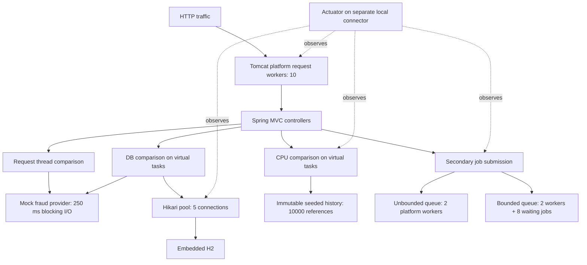
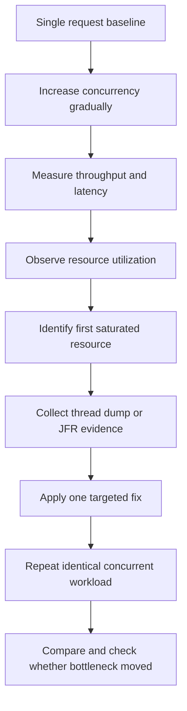
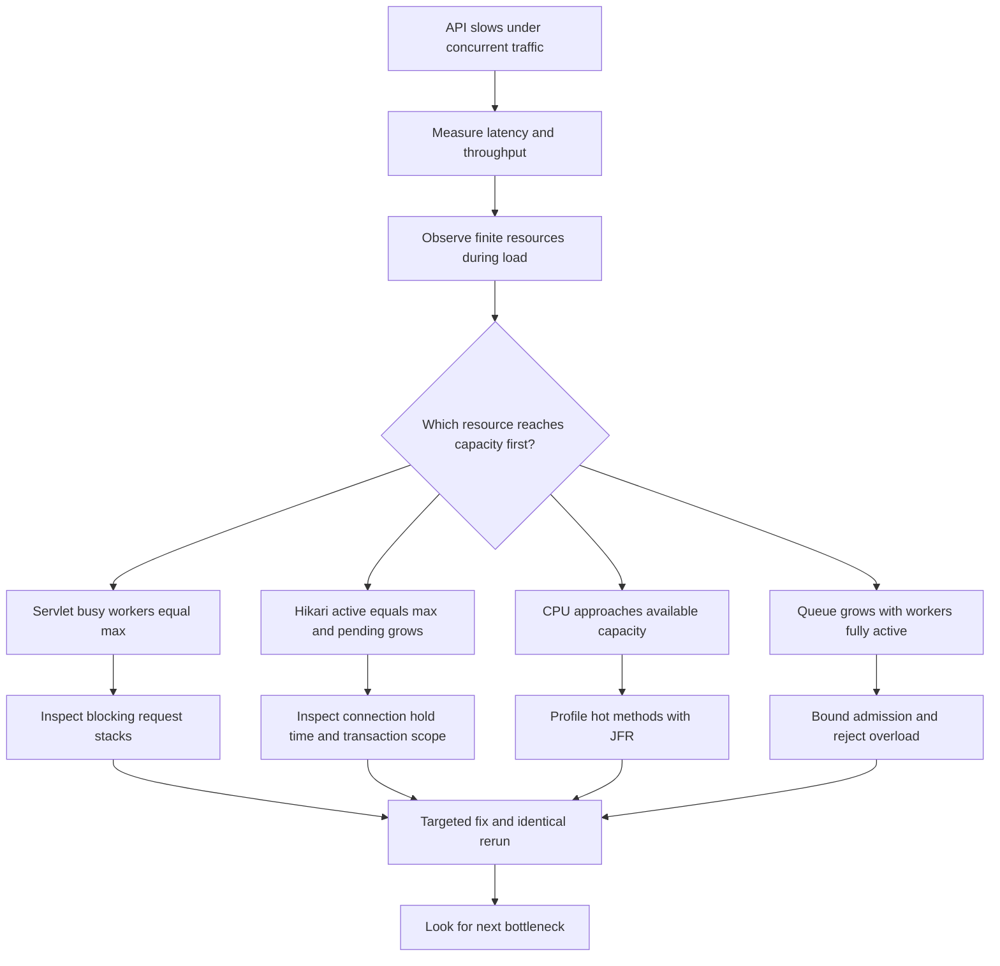

# Spring API Concurrency Bottlenecks

> A focused Spring Boot laboratory demonstrating how finite backend resources saturate under concurrent traffic and how to identify the real limiting resource.

**The implementations under the `violation` package intentionally contain concurrency and capacity anti-patterns so their behavior can be compared with corrected implementations. They are educational examples and should not be copied into production systems.**

## The Problem

“Too many requests hit your API simultaneously. What could become the bottleneck?”

The API is fast when tested manually, but response time increases dramatically when many requests arrive simultaneously. A fictional transfer authorization API makes this visible without a full banking system. All accounts and transfers are deterministic fake data.

**Under concurrency, performance is usually constrained by the first finite resource that becomes saturated.** Candidates include request threads, database connections, CPU cores, worker queues, downstream capacity, the database itself, network, and memory. This laboratory implements exactly the first four comparisons.

## Run Locally

Requirements: **JDK 25**, Bash, curl, and Python 3 for the small diagnostic scripts. The Maven Wrapper downloads **Apache Maven 3.9.16**; Spring Boot is **4.1.1**. No WebFlux, frontend, containers, external database, credentials, or testing framework.

```bash
./mvnw --version
./mvnw clean verify
./mvnw spring-boot:run
```

Expected version lines: `Apache Maven 3.9.16` and `Java version: 25...`. Startup seeds 100 accounts and 10,000 transfers into embedded H2. There are 5,000 distinct transfer references, each occurring twice, so both CPU algorithms must return **5,000 duplicate pairs**. H2 resets on restart. Wait for startup and `/actuator/health` to report `UP` before sending load.

The Maven plugin disables `optimizedLaunch`, which otherwise limits `spring-boot:run` to tier-1 compilation for fast startup. Normal tiered JIT compilation and warmup are essential for a useful CPU comparison.

The API binds to `127.0.0.1:8080`. Actuator binds to `127.0.0.1:8081`, exposing only health and metrics. The separate management connector lets us measure saturation without waiting for an API servlet worker. Both ports must be free. Stop with Ctrl+C; Spring closes all three application executors, draining accepted queue work.

```bash
curl -sS http://127.0.0.1:8081/actuator/health
curl -sS http://127.0.0.1:8081/actuator/metrics
```

## Architecture and Resource Bottleneck Map



H2 produces the startup snapshot consumed by the CPU and queue scenarios. Those scenarios make **no database calls per request/job**, isolating CPU and worker capacity. Only the DB scenario uses JPA at request time. The request-thread scenario uses no database or CPU calculation. The mock provider is the **only sleeping application code**: its deterministic 250 ms wait represents network/TLS/remote-service waiting, not CPU processing.

All reduced capacities are **demo configuration only — not production sizing guidance**. Spring's global virtual-thread switch stays disabled so the synchronous violation really uses platform servlet workers. The corrected endpoint releases the servlet worker with `WebAsyncTask`, then executes the same blocking mock on a managed virtual task. The DB and CPU pairs use that identical async execution mechanism on both sides so servlet scarcity does not hide their intended resource constraint.

| Resource | Violation | Symptom | Evidence | Solution |
|---|---|---|---|---|
| Request threads | Blocking I/O occupies platform workers | Incoming requests queue | Busy workers reach maximum | Async MVC + virtual task |
| DB connections | Transaction spans external I/O | Acquisition waits | Hikari active=max, pending>0 | Narrow transaction |
| CPU | Repeated pairwise reference scanning | CPU pressure and rising latency | CPU metrics + JFR hotspot | Hash-based frequency lookup |
| Worker queue | Unbounded acceptance | Backlog and completion delay grow | Queue depth and waiting timer | Bounded queue + explicit rejection |

## Investigation Workflow



## Before vs After: Actual Local Measurements

Recorded **8 October 2026**, Linux x86_64, Oracle JDK 25.0.4.1, Maven 3.9.16, Spring Boot 4.1.1, Tomcat 11.0.24, H2 2.4.240, **8 processors reported by the JVM**. Normal tiered compilation enabled. Each implementation received ten warmup requests, then three sequential baseline requests. Each pair then received **three attempts of 80 requests at concurrency 40**, with identical data. Runs were sequential, and queue runs fully drained before the next run. The shell process startup, curl connection overhead, machine load, and diagnostic polling are included.

The checked-in [measurement data](docs/measurements.json) preserves each attempt's summary, observed utilization peaks, connection/job timer deltas, queue outcomes, and baseline. Raw curl responses and timestamped samples were collected under `/tmp`, outside the repository. Numbers below are rounded medians **of the three attempt-level statistics**, not pooled percentiles.

| Scenario | Concurrency | Violation mean latency | Solution mean latency | Main observed evidence |
|---|---:|---:|---:|---|
| Request threads | 40 | 759.8 ms | 264.7 ms | Busy workers 10/10 vs sampled peak at most 3 |
| DB pool | 40 | 1538.3 ms | 269.5 ms | Pending peak 34–35 vs 0–4; shorter connection hold |
| CPU | 40 | 2857.2 ms | 17.4 ms | Process CPU peak 82.3–88.5%; identical 5000 pairs |
| Work queue: accepted-job completion | 40 | 9166.4 ms | 1618.5 ms | Depth 78 vs 8; solution rejects 70/80 |

The queue row measures **completion of accepted jobs**, using timer deltas. All other rows measure HTTP client latency. The bounded queue accepts less work during overload; it does not make individual jobs faster.

### Request statistics

Every row below uses 80 requests per attempt. Success/rejection counts were identical across the three attempts. Queue HTTP statistics describe submission responses, including rejections; they must not be read as completed-job throughput.

| Scenario/version | Baseline mean ms, concurrency 1 | Success / rejection | Total burst duration s | Responses/s | Mean ms | p50 ms | p95 ms | p99 ms |
|---|---:|---:|---:|---:|---:|---:|---:|---:|
| Threads violation | 255.2 | 80 / 0 | 2.130 | 37.57 | 759.8 | 902.6 | 993.2 | 998.3 |
| Threads solution | 254.7 | 80 / 0 | 0.849 | 94.20 | 264.7 | 261.6 | 287.3 | 292.3 |
| DB violation | 258.8 | 80 / 0 | 4.158 | 19.24 | 1538.3 | 1924.0 | 2008.3 | 2036.9 |
| DB solution | 258.9 | 80 / 0 | 0.842 | 95.00 | 269.5 | 263.4 | 294.7 | 328.2 |
| CPU violation | 557.2 | 80 / 0 | 7.326 | 10.92 | 2857.2 | 2363.9 | 4694.0 | 5965.4 |
| CPU solution | 4.2 | 80 / 0 | 0.419 | 190.80 | 17.4 | 14.4 | 32.0 | 47.9 |
| Queue violation: submission | 1.3 | 80 / 0 | 0.418 | 191.59 | 9.5 | 8.1 | 23.1 | 36.1 |
| Queue solution: submission | 1.1 | 10 / 70 | 0.402 | 199.20 | 12.0 | 9.9 | 28.9 | 49.8 |

All non-queue endpoints returned HTTP 200; accepted jobs returned 202; bounded overload returned 503. No network failures, other errors, or failed jobs were observed. Queue successes mean accepted submissions, with subsequent completion verified after drain.

Variation matters: mean thread latency was 754.9–781.7 ms vs 261.3–278.5 ms; DB was 1534.6–1543.0 ms vs 266.3–291.7 ms; CPU was 2520.1–3060.8 ms vs 13.6–19.6 ms. CPU violation p95 varied from 4117.4 to 5480.2 ms; DB violation p99 varied from 2034.8 to 3155.7 ms. Queue solution submission p95 varied from 25.5 to 94.2 ms. Tiny samples and a shared local host make these observations noisy.

### Measured visual comparison

Median mean **HTTP latency** at concurrency 40; one full block is approximately 100 ms. The short marker represents less than one block. Queue submission is excluded because it measures a different operation.

```text
Threads violation  ████████                      759.8 ms
Threads solution   ███                           264.7 ms
DB violation       ███████████████               1538.3 ms
DB solution        ███                           269.5 ms
CPU violation      █████████████████████████████ 2857.2 ms
CPU solution       ▏                              17.4 ms
```

### Root-cause evidence

- **Threads:** every violation run reached ten busy workers, while the solution's sampled peaks were 0–3. Both returned the same risk score after the same 250 ms provider wait. Hikari stayed idle. A separate in-load thread dump found **ten servlet workers in the mock provider**, substantiating blocked worker saturation.
- **DB:** each violation run reached active=5, idle=0, pending=34–35. The solution still briefly reached active=5 and pending=4 in its first burst; subsequent sampled pending peaks were zero. Average **connection hold time**, computed from `hikaricp.connections.usage` deltas, fell from **253.4–256.1 ms** to **3.2–11.7 ms** without changing the five-connection pool. A virtual-thread dump showed five provider waits inside the transaction and 35 Hikari acquisition waits.
- **CPU:** violation process CPU peaks were **82.3–88.5%**, system CPU reached 100%, and Hikari active/pending stayed zero. The solution's sampled process CPU peaks were 7.6–22.0%. Every successful CPU response in all attempts reported 10000 transfers and 5000 pairs. System CPU was already high in other scenarios, so system load alone cannot attribute CPU pressure to this application; process metrics and JFR supply the stronger evidence.
- **Queue:** both variants reached two active workers. Violation depth peaked at **78 in every run**, accepted all 80, and had average queue wait **8700.0–8965.9 ms** and mean job completion **9128.0–9424.1 ms**. The solution capped depth at **8**, accepted 10, rejected 70, and had mean completion **1544.2–1797.5 ms** for those accepted jobs. Latest completion timings were **16.80–18.12 s** vs **2.36–3.03 s**. All accepted jobs completed with the same fingerprint `1292498`; failure counters remained zero. Full capture including drain took **17.28–18.77 s** vs **2.60–3.31 s**.

Local demonstration measurements vary by machine and should not be interpreted as production benchmarks.

A separate, verified 30-second `settings=profile` JFR recording collected **1721 `jdk.ExecutionSample` events**, of which **1720 contained `RiskCalculationViolationService.calculate`** in their stack, often below the string comparison work. This supports the hot-method hypothesis; it is not a percentage of exact CPU time. The recording was taken after the comparison runs so profiling overhead did not affect their reported values.

> These measurements are educational local observations, not portable benchmark claims. Results depend on CPU, JVM warmup, operating system, machine load, dataset size, and concurrency settings.

## Endpoints and Reproduction Matrix

No request body is required. DB requests optionally accept `accountId=1` through `100`; default is `1`.

| Method | Path suffix under `/api/v1/concurrency` | Single request | Concurrent load | Expected evidence |
|---|---|---|---|---|
| GET | `/request-threads/{violation,solution}` | Mock risk score `12` | Platform waiting vs virtual waiting | Busy API workers reach 10 in violation |
| POST | `/db-pool/{violation,solution}` | Account authorized, risk score `12` | Long vs short connection hold | Pending acquisitions in violation |
| POST | `/cpu/{violation,solution}` | 10000 transfers, 5000 duplicate pairs | Quadratic vs linear work | JFR calculation hotspot |
| POST | `/work-queue/{violation,solution}` | HTTP 202 + job ID | Accept everything vs bounded admission | Growing depth vs 503 rejections |
| GET | `/work-queue/metrics` | Both queue snapshots | Active/depth/completed/rejected/failed | Latest completed job timing + fingerprint |

Call **all eight implementations**:

```bash
curl -sS http://127.0.0.1:8080/api/v1/concurrency/request-threads/violation
curl -sS http://127.0.0.1:8080/api/v1/concurrency/request-threads/solution
curl -sS -X POST 'http://127.0.0.1:8080/api/v1/concurrency/db-pool/violation?accountId=1'
curl -sS -X POST 'http://127.0.0.1:8080/api/v1/concurrency/db-pool/solution?accountId=1'
curl -sS -X POST http://127.0.0.1:8080/api/v1/concurrency/cpu/violation
curl -sS -X POST http://127.0.0.1:8080/api/v1/concurrency/cpu/solution
curl -sS -X POST http://127.0.0.1:8080/api/v1/concurrency/work-queue/violation
curl -sS -X POST http://127.0.0.1:8080/api/v1/concurrency/work-queue/solution
curl -sS http://127.0.0.1:8080/api/v1/concurrency/work-queue/metrics
```

`ScenarioResponse.elapsedMs` measures time from controller entry to work completion, including transaction commit in the DB scenario. It excludes waiting **before** the controller. The load script measures end-to-end curl latency, which includes that important queueing time.

### Controlled concurrent traffic

```bash
seq 1 80 | xargs -P40 -I{} curl -sS -o /dev/null \
  'http://127.0.0.1:8080/api/v1/concurrency/request-threads/violation?request={}'
```

For timings and status counts, the executable script uses `seq`, `xargs`, and curl, with Python's standard library for percentiles. It launches a finite workload, gives each request separate output files, and prints a JSON summary. Default raw output goes to `/tmp`; an optional fifth argument selects a fresh output directory. No load-testing framework or performance-test module is included.

```bash
./scripts/load.sh GET /api/v1/concurrency/request-threads/violation 80 40
./scripts/load.sh GET /api/v1/concurrency/request-threads/solution 80 40
./scripts/load.sh POST /api/v1/concurrency/db-pool/violation 80 40
./scripts/load.sh POST /api/v1/concurrency/db-pool/solution 80 40
./scripts/load.sh POST /api/v1/concurrency/cpu/violation 80 40
./scripts/load.sh POST /api/v1/concurrency/cpu/solution 80 40
./scripts/load.sh POST /api/v1/concurrency/work-queue/violation 80 40
# Wait for activeWorkers=0 and queueDepth=0 before the next queue run.
curl -sS http://127.0.0.1:8080/api/v1/concurrency/work-queue/metrics
./scripts/load.sh POST /api/v1/concurrency/work-queue/solution 80 40
```

DB load rotates across the seeded accounts to avoid creating an accidental same-row lock bottleneck. Use count `1`, concurrency `1` for a baseline. Warm each endpoint several times, use the same dataset/count/concurrency for each pair, repeat at least three times, and run scenarios separately. CPU and queue runs can be slower on smaller laptops; keep workloads finite. Do not continuously flood the intentional unbounded queue.

## Bottleneck 1 — Servlet Request Thread Saturation

**Symptom:** the mock still takes 250 ms, but client latency grows as ten platform workers all wait. Requests queue before entering the controller, so internal `elapsedMs` alone understates the problem.

**Violation:** `BlockingFraudCheckViolationService.check()` runs directly on the servlet worker. `server.tomcat.threads.max: 10` and `min-spare: 2` make this reproducible locally. The pool's theoretical wait-dominated ceiling is approximately `10 / 0.25 = 40 requests/s`, before overhead; this is an estimate, not a measurement.

**Solution:** `RequestThreadController.solution()` returns an asynchronous MVC result:

```java
return new WebAsyncTask<>(30_000L, executor,
        () -> ScenarioResponse.measured("REQUEST_THREADS", "SOLUTION", started, solution.check()));
```

The singleton executor uses `Executors.newThreadPerTaskExecutor(Thread.ofVirtual().name("demo-virtual-", 0).factory())`, the named-thread equivalent of `Executors.newVirtualThreadPerTaskExecutor()`. Spring closes it during shutdown. Servlet workers perform short admission/response dispatches while virtual threads wait for the same provider. No executor is created per request.

**Why virtual threads help:** blocked virtual tasks usually release their carrier CPU threads. More in-flight blocking I/O can proceed without one expensive platform thread per request. Understand native blocking and pinning when relevant; Java 25 includes modern monitor behavior, so older claims about every synchronized block pinning are inappropriate.

**Why increasing Tomcat threads is not the first fix:** it consumes more platform-thread resources and can move pressure downstream. First inspect the waiting stacks and the capacity of dependencies.

**Virtual threads improve scalability for blocking I/O, but they do not create infinite capacity.** They do not fix Hikari connection limits, CPU saturation, remote rate limits, memory exhaustion, or unbounded queues. This showcase intentionally does not add admission control to the virtual-thread endpoint; production admission and timeouts require separate capacity design.

## Bottleneck 2 — Database Connection Pool Exhaustion

**Violation:** `ConnectionPoolViolationService.authorize()` enters a proxied `@Transactional` method, reads an account (actually acquiring a Hikari connection), waits for the mock provider, updates the managed entity, and commits. Five connections can be occupied by waiting requests even while H2 itself is doing little work.

```text
transaction → DB read → external 250 ms wait → DB update → commit/release
```

**Detection:** active connections at 5, idle at 0, and pending acquisitions above 0 indicate pool pressure. Acquisition and usage timers distinguish time waiting **for** a connection from time **holding** it. This uses the real Hikari pool, no artificial semaphore.

**Solution:** `ShortTransactionSolutionService` makes the external call first, then invokes a separate Spring-managed `AccountAuthorizationService.authorize()` for the short transaction:

```text
external wait → transaction → read current account → update → commit/release
```

The separate collaborator preserves proxy semantics; no transactional self-invocation. Open EntityManager in View is disabled. The fictional fraud score is independent of changing account state, and recording the same score is idempotent; the demo does not debit balances or promise bank-transfer atomicity. In a real authorization workflow, validate current state in the final transaction and decide how stale external information is handled. Narrower transactions require careful business consistency design.

**Why not just increase pool size?** Increasing the connection pool can delay symptoms without fixing unnecessarily long connection-hold times. Real sizing depends on database capacity, workload, transaction and query duration, instance count, and database connection limits. There is no magical production pool size.

## Bottleneck 3 — CPU Saturation

`RiskCalculationViolationService.calculate()` compares every unordered pair of historical references. `RiskCalculationSolutionService.calculate()` counts previous occurrences in a `HashMap`: each new occurrence contributes that many duplicate pairs. Both return the same result for the same history, including references repeated more than twice.

| Version | Approximate complexity | Additional memory |
|---|---|---|
| Violation | O(n²) | O(1) beyond shared history |
| Solution | O(n) average | O(u), where u is distinct references |

Big-O describes growth in work, not milliseconds. The violation performs real comparisons; no sleep and no giant dataset. The optimized version trades a modest hash table for much less CPU work. The snapshot loaded from H2 is immutable for the lifetime of the process, making the comparison independent of DB acquisition.

**More threads ≠ more CPU.** Virtual threads are primarily a scalability tool for blocking workloads. They do not make CPU-intensive calculations execute faster. With finite cores, additional CPU tasks contend for time; throughput eventually plateaus while latency grows. On a many-core host, 40 requests may create pressure without saturating the whole machine. Use CPU normalization and profiling evidence before claiming full saturation.

### Thread dumps and JFR

Find the **application JVM**, not the Maven launcher:

```bash
jcmd -l
# Set the PID reported for ConcurrencyBottlenecksApplication:
APP_PID=12345
jcmd "$APP_PID" Thread.print > /tmp/concurrency-threads.txt
jcmd "$APP_PID" Thread.dump_to_file -format=json /tmp/concurrency-threads.json
jcmd "$APP_PID" JFR.start name=concurrency-profile settings=profile duration=30s filename=/tmp/concurrency.jfr
./scripts/load.sh POST /api/v1/concurrency/cpu/violation 80 40
# After the recording's 30 seconds:
jfr summary /tmp/concurrency.jfr
jfr print --events jdk.ExecutionSample /tmp/concurrency.jfr
```

`12345` is a placeholder to replace with the actual PID. `Thread.print` shows platform workers; `Thread.dump_to_file` includes virtual threads. During the thread violation, inspect servlet stacks in `MockFraudProvider.check` / `Thread.sleep`. During DB violation, inspect virtual stacks waiting in Hikari acquisition and others holding connections across the provider call. `RUNNABLE` can include native work or I/O; `WAITING`/`TIMED_WAITING` are normal for idle and parked threads; `BLOCKED` means monitor contention. State alone is insufficient: inspect stacks and utilization.

Open the recording in [JDK Mission Control](https://www.oracle.com/java/technologies/jdk-mission-control.html), select Method Profiling / hot methods, and look for `RiskCalculationViolationService.calculate` and its string comparisons. Compare with CPU metrics and healthy DB gauges. JFR samples are statistical: absence of a sample does not prove absence of work. `.jfr` files are ignored and not committed. CLI recording and inspection commands are verified; graphical Mission Control inspection is a reader workflow.

## Bottleneck 4 — Unbounded Queue Growth

**Violation:** two platform workers with a real `LinkedBlockingQueue` accept all submitted jobs. Each job computes the same deterministic secondary transfer-reference fingerprint, with 100 SHA-256 derivation rounds per reference. This supplies finite real batch CPU work, rather than sleeping to manufacture a queue. It is a synthetic local cost, not a production fraud algorithm. Every job's fingerprint is consumed and observable in the latest completion snapshot.

**Symptom:** submission is quick (202), but queue wait and end-to-end **job completion** latency grow. HTTP submission latency is not job latency. Accepted jobs may wait excessively; longer-lived queued tasks can eventually cause memory pressure. This lab uses small finite bursts and does not deliberately exhaust memory.

**Solution:** identical job cost and two workers, with an `ArrayBlockingQueue` of eight and `AbortPolicy`. At most two jobs execute and eight wait. Additional work returns **503 Service Unavailable**, because shared service capacity is temporarily exhausted rather than a per-client quota. The response includes `Retry-After: 1` and:

```json
{"code":"CAPACITY_EXCEEDED","message":"Risk evaluation capacity is temporarily exhausted."}
```

No silent drops. Job IDs are returned only after acceptance. A concurrent queue-depth snapshot is an observation, not a reservation. The latest completion is retained; this deliberately does not build a persistent job registry. Failed tasks increment `demo.queue.failed` and propagate to the worker's exception handling rather than being swallowed.

```text
Without backpressure                 With bounded admission
2 workers                            2 workers
80 jobs can all be accepted           8 waiting slots
backlog grows                        capacity reached
completion delay grows               excess jobs rejected quickly
memory pressure possible             caller can retry with bounded backoff
```

**When the system cannot safely process more work, controlled rejection is often healthier than accepting unlimited work and failing later.** Bounded queues bound pending memory and wait; they do not guarantee a particular completion deadline. Retry-After is advisory, and clients should use bounded retries with jitter.

## Diagnostic Decision Tree

### Actual runtime metric names

These names were discovered from the running Spring Boot 4.1.1 / Tomcat 11.0.24 application and queried successfully, rather than inferred from examples. Timers expose `COUNT`, `TOTAL_TIME`, and `MAX` in seconds; gauges expose `VALUE`. Timer maximums are time-window values; counts and totals are cumulative. Compare before/after deltas to isolate a run.

| Category | Verified metric names | Relevant tag |
|---|---|---|
| Servlet workers | `tomcat.threads.current`, `tomcat.threads.busy`, `tomcat.threads.config.max` | `name:http-nio-127.0.0.1-8080` |
| Hikari gauges | `hikaricp.connections.active`, `hikaricp.connections.idle`, `hikaricp.connections.pending`, `hikaricp.connections.max` | `pool:demo-pool` |
| Hikari timing | `hikaricp.connections.acquire`, `hikaricp.connections.usage` | `pool:demo-pool` |
| HTTP | `http.server.requests` | `uri`, `method`, `status`, `outcome`, `exception`, `error` |
| CPU | `process.cpu.usage`, `system.cpu.usage`, `system.cpu.count` | No tag required |
| Queue gauges | `demo.queue.active`, `demo.queue.pool.size`, `demo.queue.depth`, `demo.queue.completed` | `implementation:violation` or `implementation:solution` |
| Queue counters | `demo.queue.rejected`, `demo.queue.failed` | Same implementation tag |
| Queue timing | `demo.queue.waiting`, `demo.queue.completion` | Same implementation tag |

`demo.queue.completed` counts all finished executor tasks; consult `demo.queue.failed` for failures. `waiting` measures submission-to-start; `completion` includes queue wait plus work. The job snapshot exposes only the latest successful completion. HTTP meters appear after the first matching request. There is no direct Tomcat “requests waiting” gauge used here: infer queueing from busy=max, stable service time, and rising client latency. CPU usage is a fraction, not a percentage; normalize against the CPU capacity reported by the JVM and any OS quota/affinity.

```bash
curl -sS 'http://127.0.0.1:8081/actuator/metrics/tomcat.threads.busy?tag=name:http-nio-127.0.0.1-8080'
curl -sS 'http://127.0.0.1:8081/actuator/metrics/hikaricp.connections.pending?tag=pool:demo-pool'
curl -sS 'http://127.0.0.1:8081/actuator/metrics/hikaricp.connections.usage?tag=pool:demo-pool'
curl -sS http://127.0.0.1:8081/actuator/metrics/process.cpu.usage
curl -sS 'http://127.0.0.1:8081/actuator/metrics/demo.queue.depth?tag=implementation:solution'
curl -sS 'http://127.0.0.1:8081/actuator/metrics/http.server.requests?tag=uri:/api/v1/concurrency/cpu/violation'
```

To sample utilization while the finite burst runs, use the standard-library wrapper around the same shell command:

```bash
python3 scripts/capture.py GET /api/v1/concurrency/request-threads/violation 80 40
python3 scripts/capture.py POST /api/v1/concurrency/db-pool/violation 80 40
python3 scripts/capture.py POST /api/v1/concurrency/cpu/violation 80 40
python3 scripts/capture.py POST /api/v1/concurrency/work-queue/solution 80 40
```

Replace the implementation suffix to compare the other version. Capture writes a curl summary and timestamped metric samples under `/tmp`, polls gauges serially approximately every 100 ms plus HTTP overhead, and waits for queues to drain. Gauges can miss short-lived peaks and are not atomic across resources. Polling itself has cost and is part of the reported local experiment. A 120-second capture limit prevents an indefinitely blocked diagnostic script.



| Observation | Likely investigation |
|---|---|
| Request workers consistently at maximum | Blocking request work |
| Hikari active=max and pending grows | Connection hold time, queries, pool/database capacity |
| CPU approaches available capacity | CPU algorithms and profiling |
| Queue grows while all workers remain active | Worker capacity and admission |
| Latency grows while CPU remains low | Waiting, blocking, locks, downstream I/O |

These are diagnostic clues, not absolute rules. Correlate them with stacks and workload behavior before declaring a root cause.

## Why One Request Can Look Healthy

A single 250 ms provider call needs one worker. More requests can overlap until the finite pool fills. After that, requests wait their turn even though the individual provider call has not become intrinsically slower. When a resource approaches full utilization, queueing delay can grow rapidly.

**Latency** is the time for one request. **Throughput** is completed requests per second. As concurrency rises, throughput initially increases, then plateaus at capacity while latency continues increasing. **Concurrency** means tasks are in progress; **parallelism** means tasks execute simultaneously. A thousand concurrent requests do not mean a thousand operations run physically on CPU at once.

p50 is the median latency; p95 and p99 describe the slow tail. A low average can hide poor experience for the slowest users. Small local samples make high percentiles noisy; the script uses nearest-rank percentiles and includes all response statuses in its latency distribution. A rejection's short latency must never be interpreted as successful job completion.

### Little's Law intuition

`average in-flight concurrency ≈ throughput × average time in system`. For a **conceptual steady-state example**, 100 completions/s × 0.2 s = approximately 20 in-flight operations. It is operational intuition, not a tuning formula; unstable growing queues and transient bursts need different interpretation.

## The System Is Limited by Its Narrowest Resource

Request threads → CPU → DB connections → database → downstream resources form a capacity chain. Not every workflow uses every resource, and the units differ; identify the limiting stage for the actual workload. When arrival rate exceeds sustainable processing capacity, waiting grows, then timeouts and errors appear.

### Thread pool vs connection pool

In this lab there are ten platform servlet workers but five Hikari connections. That does not allow ten simultaneous database operations needing a connection. The DB async pair can start many virtual tasks, but still only five connections can be borrowed at once. Additional tasks wait. Increasing upstream concurrency increases downstream pressure.

### Virtual threads leave downstream capacity unchanged

```text
10 platform request workers
    ↓ async MVC offload
many virtual tasks possible
    ↓
Hikari pool still 5
    ↓
H2 and CPU capacity unchanged
```

## Fixing One Bottleneck Can Reveal the Next

Before: request workers saturate first. After offloading blocking I/O: more operations can reach the database together, so its connection pool may become the next constraint. This is normal. Optimization is iterative; repeat the workload and re-check all resources after every fix.

## Why Increasing Pool Sizes Can Make Things Worse

More request workers → more concurrent DB requests → more connections → more database pressure → database saturation. A larger queue → more pending work → higher latency and retained memory. Capacity changes must be coordinated with downstream capacity. Sometimes capacity really is insufficient, but prove that useful work, rather than unnecessary resource holding, consumes it.

## Questions I Ask Before Changing Anything

- Is it slow with one request or only under concurrency?
- At what concurrency does latency begin rising?
- Does throughput still increase or plateau?
- Are request workers at their maximum? What do their stacks show?
- Are DB connections fully utilized, and are acquisitions pending?
- Is CPU saturated relative to available cores/quota?
- Are application queues growing? Are errors or timeouts increasing?
- Which resource reaches capacity first?
- Is capacity undersized, or does code hold the resource unnecessarily long?

## How I Would Investigate an API That Slows Down Under Load

1. Reproduce with controlled concurrency, including a single-request baseline.
2. Measure end-to-end latency, tail percentiles, status counts, and throughput; locate the performance knee.
3. Check servlet request-worker utilization.
4. Check connection utilization, pending acquisitions, acquisition time, and hold time.
5. Check CPU relative to available capacity.
6. Inspect queue depth, worker activity, and completion latency.
7. Collect thread dumps and/or JFR while the symptom occurs.
8. Form a hypothesis: for example, active=max, pending rising, and modest CPU suggest connection pressure.
9. Apply one targeted fix supported by that evidence.
10. Run exactly the same load again.
11. Determine whether the first constraint improved and another bottleneck appeared.

## What I Would Not Do First

Increase Tomcat workers or DB connections blindly; make everything asynchronous; enable virtual threads and assume the issue is solved; add caching without evidence; accept unlimited queued work; retry overloaded dependencies aggressively; or buy a larger server before identifying the limiting resource.

## Healthy Overload Behavior

Normal load should have normal latency. Approaching capacity may increase latency; exceeding safe capacity should cause predictable rejection or a bounded timeout. An unbounded backlog followed by memory exhaustion and total failure is unhealthy. The queue solution demonstrates deliberate rejection, with the trade-off that some jobs are never accepted.

## Trade-offs and Production Perspective

| Solution | Advantage | Trade-off |
|---|---|---|
| Virtual tasks | More overlapping blocking I/O with imperative code | Downstream limits, memory, CPU, pinning/native blocking still matter |
| Narrow transaction | Shorter connection hold, better pool availability | Business consistency across external work requires design |
| Hash lookup | Less CPU work and better throughput | Additional memory for distinct references |
| Bounded queue | Predictable backlog and controlled overload | Excess jobs are explicitly rejected |

A real investigation may also use APM, dashboards, JVM/OS/database metrics, downstream timing, load-balancer metrics, distributed tracing, error rates, and p95/p99 latency. Production remedies may include rate limiting, load shedding, bulkheads, timeouts, circuit breakers, autoscaling, bounded retries, replicas, and caching. Each addresses a different constraint; apply them from evidence. None of those platforms or libraries is implemented here.

## How I Would Answer This in an Interview

“I would look for saturation of finite shared resources. First I would reproduce the slowdown with controlled concurrent traffic and compare throughput and latency with servlet, Hikari, CPU, and queue metrics. Busy servlet workers require stack inspection: are they doing work or waiting? Active DB connections at the maximum with rising pending acquisitions point toward pool pressure or long transactions. High CPU needs JFR profiling; a growing work queue needs bounded admission. I would fix the constraint supported by those measurements, repeat the same workload, and check whether the bottleneck moved.”

## What I Learned

- Concurrency exposes problems invisible during manual testing; every backend resource has finite capacity.
- Thread count and throughput differ; blocked servlet workers can create queueing before controller timing begins.
- Hold DB connections for the shortest practical time; blindly increasing pools can overload the database.
- CPU work is bounded by CPU capacity; virtual threads help blocking workloads, not inefficient calculations.
- Unbounded queues hide overload; controlled rejection is often safer than unlimited acceptance.
- Fixing one bottleneck can reveal another; performance tuning should follow measurements.

## Project Structure

```text
spring-api-concurrency-bottlenecks/
├── .gitignore
├── .mvn/wrapper/maven-wrapper.properties
├── mvnw
├── mvnw.cmd
├── pom.xml
├── README.md
├── docs/
│   └── measurements.json
├── scripts/
│   ├── capture.py
│   └── load.sh
└── src/main/
    ├── resources/application.yml
    └── java/com/example/concurrencybottlenecks/
        ├── ConcurrencyBottlenecksApplication.java
        ├── config/
        │   ├── DemoDataInitializer.java
        │   ├── ExecutorConfiguration.java
        │   └── WorkQueueConfiguration.java
        ├── controller/
        │   ├── CapacityExceptionHandler.java
        │   ├── ConnectionPoolController.java
        │   ├── CpuController.java
        │   ├── RequestThreadController.java
        │   └── WorkQueueController.java
        ├── diagnostics/
        │   └── JobQueue.java
        ├── dto/
        │   ├── AuthorizationResult.java
        │   ├── RiskResult.java
        │   └── ScenarioResponse.java
        ├── entity/
        │   ├── Account.java
        │   └── Transfer.java
        ├── repository/
        │   ├── AccountRepository.java
        │   └── TransferRepository.java
        └── service/
            ├── AccountAuthorizationService.java
            ├── MockFraudProvider.java
            ├── RiskHistory.java
            ├── SecondaryRiskEvaluationService.java
            ├── solution/
            │   ├── BoundedQueueSolutionService.java
            │   ├── RiskCalculationSolutionService.java
            │   ├── ShortTransactionSolutionService.java
            │   └── VirtualThreadFraudCheckSolutionService.java
            └── violation/
                ├── BlockingFraudCheckViolationService.java
                ├── ConnectionPoolViolationService.java
                ├── RiskCalculationViolationService.java
                └── UnboundedQueueViolationService.java
```

The script-only Maven Wrapper needs no committed wrapper JAR. No `src/test`, frontend, deployment files, load-testing framework, or infrastructure is included.

## Verification Performed

- Maven Wrapper version and Java 25 verified; `./mvnw clean verify` passed with no compilation warnings.
- `./mvnw spring-boot:run` started successfully; H2 seeding, both ports, health, and all eight implementation endpoints verified.
- Every implementation warmed and run in three concurrent attempts; all non-queue requests succeeded with equivalent results.
- Actual servlet/Hikari/CPU/HTTP/custom queue metric names and tags discovered and queried.
- Platform saturation, real Hikari pending acquisitions and shortened hold times, CPU hotspots, unbounded backlog, bounded capacity, and clean 503 rejection observed.
- Accepted queue work drained with matching fingerprints and zero failures; application executors closed through Spring lifecycle.
- Java 25 platform and virtual thread dumps, JFR recording, `jfr summary`, and execution-sample inspection verified. Recordings remain outside the repository and are ignored.
- The detailed Mission Control GUI workflow is documented but was not executed. Measurements are local diagnostics, not production capacity guarantees.

## References

- [Spring Boot application properties](https://docs.spring.io/spring-boot/appendix/application-properties/index.html): Tomcat worker limits and MBean configuration.
- [Spring MVC asynchronous requests](https://docs.spring.io/spring-framework/reference/web/webmvc/mvc-ann-async.html): releasing servlet workers and asynchronous execution.
- [Java 25 jcmd](https://docs.oracle.com/en/java/javase/25/docs/specs/man/jcmd.html): thread dump and JFR commands.
- [Maven 3.9.16 release notes](https://maven.apache.org/docs/3.9.16/release-notes.html).
