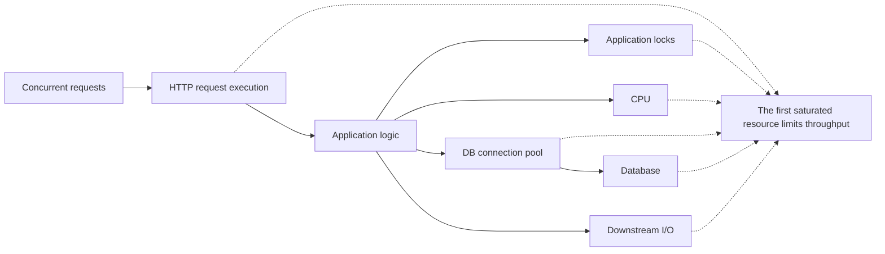
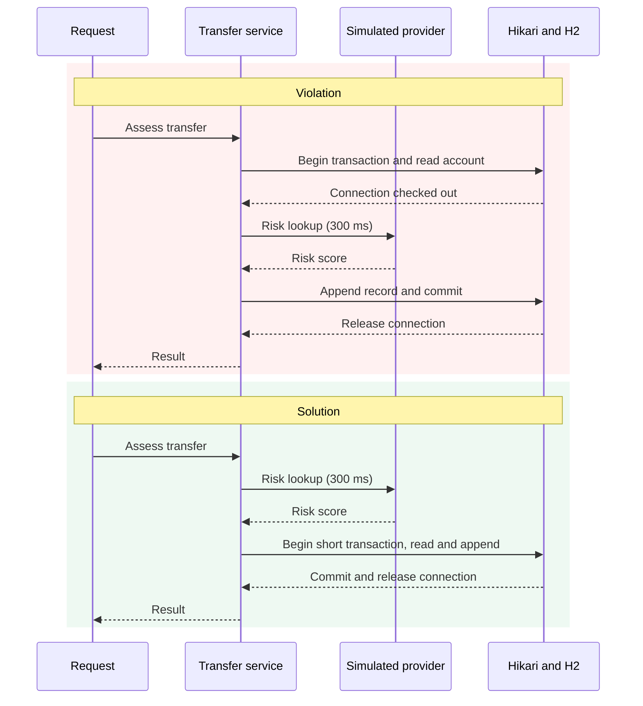
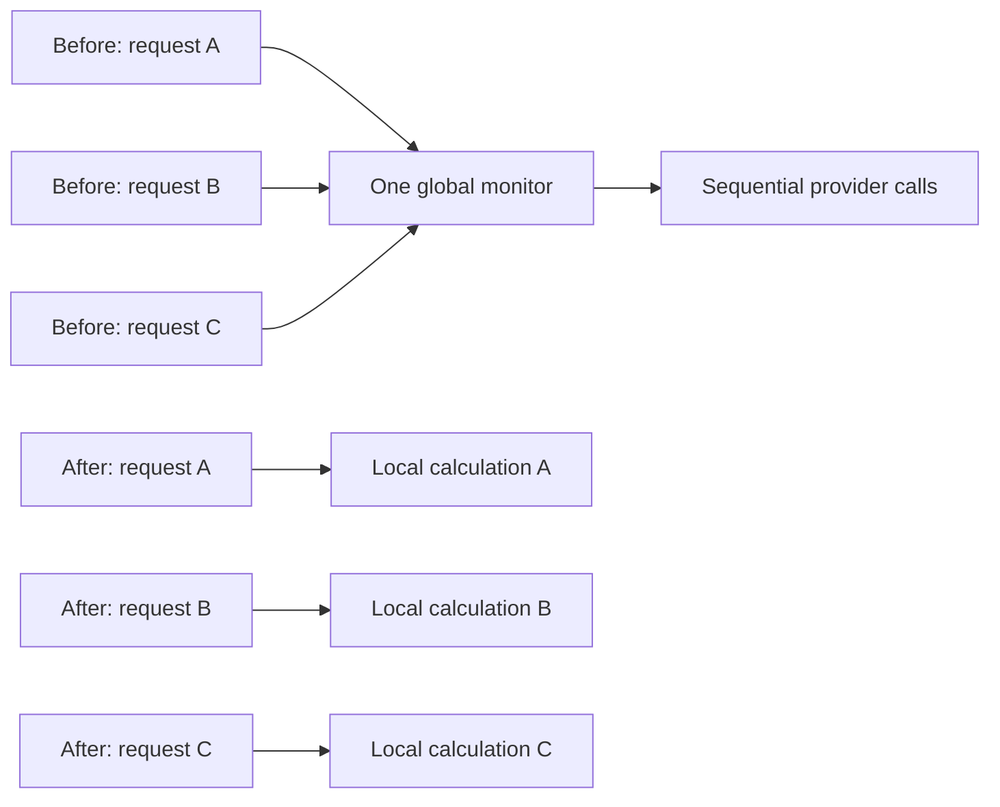
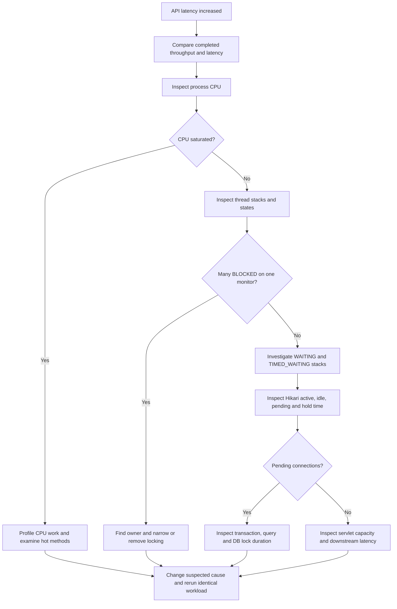

# API Saturation Bottlenecks

## Executive Summary

**Too many requests hit the API simultaneously. What becomes the bottleneck? Whichever constrained resource reaches capacity first.** High traffic exposes a capacity limit; it does not identify the root cause. HTTP workers, downstream I/O, database connections, the database itself, application locks, CPU, memory/GC, and remote services can all constrain an API.

This small Java 25 / Spring Boot 4.1.1 showcase isolates **four** representative causes in a fictional transfer-processing service. Each has an intentionally problematic implementation, a corrected implementation, reproducible concurrent traffic, and actual diagnostic evidence. No frontend, external service, deployment infrastructure, or test suite is included.

**Violation classes are deliberately problematic educational examples.** Both implementations remain available for inspection.

| Scenario | Resource Saturated | Main Cause | Primary Diagnostic Signal | Open the comparison |
|---|---|---|---|---|
| A: Blocking I/O | HTTP request workers | Sequential provider waits occupy servlet threads | Busy workers reach their limit; sleeping servlet stacks | [Violation](src/main/java/com/example/apisaturation/service/threadpool/BlockingTransferViolationService.java) / [Solution](src/main/java/com/example/apisaturation/service/threadpool/BlockingTransferSolutionService.java) |
| B: DB pool | Hikari connections | Connection held during unrelated provider work | Active=max, idle=0, pending acquisitions | [Violation](src/main/java/com/example/apisaturation/service/dbpool/ConnectionPoolViolationService.java) / [Solution](src/main/java/com/example/apisaturation/service/dbpool/ConnectionPoolSolutionService.java) |
| C: Global lock | One service monitor | Shared scratch state serializes independent requests | Many BLOCKED threads behind the same owner | [Violation](src/main/java/com/example/apisaturation/service/locking/LockContentionViolationService.java) / [Solution](src/main/java/com/example/apisaturation/service/locking/LockContentionSolutionService.java) |
| D: CPU | Processor capacity | Quadratic duplicate-reference scanning | High process CPU; calculation in JFR samples | [Violation](src/main/java/com/example/apisaturation/service/cpu/CpuBottleneckViolationService.java) / [Solution](src/main/java/com/example/apisaturation/service/cpu/CpuBottleneckSolutionService.java) |

## Interview Answer

I would establish where requests are queueing before choosing a fix. First compare end-to-end latency with completed-request throughput. Then inspect HTTP worker utilization, thread dumps, Hikari active/pending connections and connection hold times, CPU utilization, lock ownership, and downstream latency. A resource at capacity with requests waiting behind it is a strong hypothesis; stack traces and a controlled before/after experiment help confirm it. Increasing concurrency can simply move the queue to another resource.

## Bottleneck Mental Model



These are possible paths, not a pipeline every endpoint traverses. Throughput of the complete request path is constrained by its slowest or most saturated resource. Removing that constraint may expose the next one.

### Why latency rises near saturation

Little's Law, for a stable system and consistent measurement boundary:

```text
Average requests in the system ≈ completed requests/second × average response time
100 requests/second × 0.2 seconds ≈ 20 concurrent requests
```

If service capacity is already full, added arrivals wait rather than increase throughput. If latency becomes 2 seconds while throughput stays at 100/s, approximately 200 requests are now in flight. Their queueing increases response time further; a continuously growing overload queue has no stable average to which this formula can simply be applied.

## Running the Project

Prerequisites: **JDK 25**. Maven is downloaded by the included wrapper, pinned to **3.9.16**. The application uses Spring Boot **4.1.1**, Spring MVC REST, Spring Data JPA, HikariCP, embedded H2, and Actuator.

```bash
./mvnw --version
./mvnw clean verify
./mvnw spring-boot:run
```

Alternatively, after building:

```bash
java -jar target/api-saturation-bottlenecks-1.0.0.jar
```

Windows PowerShell:

```powershell
.\mvnw.cmd clean verify
.\mvnw.cmd spring-boot:run
```

Only run one instance. API: `http://127.0.0.1:8080`. Diagnostics: `http://127.0.0.1:8081`. Both ports must be free. A separate local management connector lets you inspect saturation while all API servlet workers are busy. Stop with Ctrl+C; Spring closes the managed executors and the Hikari pool.

```bash
curl -sS http://127.0.0.1:8081/actuator/health
curl -sS http://127.0.0.1:8081/actuator/metrics
curl -sS http://127.0.0.1:8081/actuator/threaddump > /tmp/api-saturation-threads.json
```

Health returns `{"status":"UP"}`. Only `health`, `metrics`, and `threaddump` are exposed. No secrets or external credentials are required; the blank H2 password belongs to a disposable in-memory demo database.

`data.sql` seeds six fictional accounts in USD, EUR, and GBP. `ACC-1001` and `ACC-1002` are USD accounts belonging to Demo Customer A/B. The DB scenario appends assessment records; it does not debit real balances or implement banking correctness. H2 data resets on restart. Other scenarios never query the database.

### Deliberate capacities and isolation

| Setting | Demo value | Reason |
|---|---:|---|
| Tomcat platform workers | 10 | Make servlet-worker exhaustion visible |
| Hikari maximum connections | 5 | Make connection acquisition waits reproducible |
| Simulated provider delay | 300 ms per call | Deterministic blocking I/O, never random delay |
| Lock comparison executor | 40 platform workers | Same capacity for both versions; conventional dumps show monitor ownership |
| MVC request timeout | 30 seconds | Bound an asynchronous demo request's response wait |
| Hikari acquisition timeout | 5 seconds | Excessive DB backlog can fail instead of wait indefinitely |

Global servlet virtual threads stay disabled so scenario A's violation remains observable. Its solution uses asynchronous MVC plus named virtual tasks. Both DB and CPU versions use the same asynchronous virtual executor so Tomcat scarcity does not dominate those comparisons. Both lock versions use the same 40-worker executor, with measured concurrency 20, so its worker queue is not the limiting resource. The lock executor is a diagnostic choice, not a general recommendation to allocate more platform threads.

All simulated waiting is confined to [SimulatedExternalIo](src/main/java/com/example/apisaturation/service/SimulatedExternalIo.java). Debug logging there identifies the operation and execution thread; default logging avoids per-request console noise. No preview Java features or reactive framework are needed.

## API Reference

All eight endpoints use **POST** and `Content-Type: application/json`.

| Method | Endpoint | Purpose | Body |
|---|---|---|---|
| POST | `/api/bottlenecks/thread-pool/violation` | Sequential I/O on servlet worker | Transfer |
| POST | `/api/bottlenecks/thread-pool/solution` | Parallel I/O with virtual tasks and async MVC | Transfer |
| POST | `/api/bottlenecks/db-pool/violation` | Transaction spans provider wait | Transfer |
| POST | `/api/bottlenecks/db-pool/solution` | Provider wait precedes short transaction | Transfer |
| POST | `/api/bottlenecks/lock-contention/violation` | Global monitor serializes risk assessment | Transfer |
| POST | `/api/bottlenecks/lock-contention/solution` | Independent request-local risk assessment | Transfer |
| POST | `/api/bottlenecks/cpu/violation` | Nested duplicate-reference search | References |
| POST | `/api/bottlenecks/cpu/solution` | HashSet duplicate-reference search | References |

Transfer body, also stored in [scripts/transfer.json](scripts/transfer.json):

```json
{
  "sourceAccountId": "ACC-1001",
  "destinationAccountId": "ACC-1002",
  "amount": 250.00,
  "currency": "USD"
}
```

The three transfer pairs return equivalent immutable results with `riskScore: 12` and `status: "DEMO_ASSESSED"`. Monetary values use `BigDecimal`. IDs must be distinct; amount must be positive with at most two decimal places and 17 integer digits; currency must be USD/EUR/GBP. DB processing additionally checks account existence and currency compatibility inside the transaction. Ordinary invalid input returns 400; unknown DB accounts return 404 through Spring's standard REST error handling.

References body:

```json
{"transactionReferences":["TX-10001","TX-10002","TX-10001"]}
```

Both CPU versions return `{"referenceCount":3,"repeatedReferences":1}`. Each occurrence after a reference's first occurrence counts once, including triples and longer repetitions. Requests are capped at 30,000 nonblank references of at most 64 characters. Empty input returns zero counts.

## Reproducing Every Violation

Use Bash, curl (with `--json` support), GNU `date`, `seq`, `xargs`, and awk for the small load script. Python 3 is used only to generate the larger CPU request below. No load framework is an application dependency.

1. Start the application and check health.
2. Run one request against each implementation as a baseline.
3. Run concurrent violation requests.
4. During load, inspect the relevant metric/thread dump in another terminal.
5. Run the solution with the **same request count, concurrency, and body**.
6. Compare completed throughput and end-to-end response time, then check whether the bottleneck moved.

Invoke the six transfer endpoints once:

```bash
for scenario in thread-pool db-pool lock-contention; do
  for version in violation solution; do
    curl -sS --json @scripts/transfer.json \
      "http://127.0.0.1:8080/api/bottlenecks/$scenario/$version"
    echo
  done
done
```

Invoke both CPU endpoints once:

```bash
for version in violation solution; do
  curl -sS --json '{"transactionReferences":["TX-10001","TX-10002","TX-10001"]}' \
    "http://127.0.0.1:8080/api/bottlenecks/cpu/$version"
  echo
done
```

Prepare the larger CPU body used in the measured runs: 10,000 distinct references repeated twice, 20,000 entries total. Expected result: 10,000 repeated occurrences.

```bash
python3 - <<'PYCPU'
import json
from pathlib import Path
references = [f"TX-{i:05d}" for i in range(10000)] * 2
Path('/tmp/api-saturation-cpu.json').write_text(json.dumps({"transactionReferences": references}))
PYCPU
```

Run these pairs **one at a time**, letting each finish before starting the next:

```bash
./scripts/run-load.sh /api/bottlenecks/thread-pool/violation 40 20 scripts/transfer.json
./scripts/run-load.sh /api/bottlenecks/thread-pool/solution 40 20 scripts/transfer.json

./scripts/run-load.sh /api/bottlenecks/db-pool/violation 40 20 scripts/transfer.json
./scripts/run-load.sh /api/bottlenecks/db-pool/solution 40 20 scripts/transfer.json

./scripts/run-load.sh /api/bottlenecks/lock-contention/violation 40 20 scripts/transfer.json
./scripts/run-load.sh /api/bottlenecks/lock-contention/solution 40 20 scripts/transfer.json

./scripts/run-load.sh /api/bottlenecks/cpu/violation 40 20 /tmp/api-saturation-cpu.json
./scripts/run-load.sh /api/bottlenecks/cpu/solution 40 20 /tmp/api-saturation-cpu.json
```

The script uses `xargs -P` and curl, reporting successes, errors, total burst time, mean client latency, and requests/second. Non-2xx and transport failures count as errors. Total duration includes launching local curl processes; mean latency comes from curl's `time_total`, including waiting before controller entry. Temporary status files are removed after summarizing. JVM warmup and repeated runs improve confidence; the results below are one controlled demonstration, not a statistical benchmark.

## Verified Actuator Metrics

Names were checked against this running Spring Boot 4.1.1 application; the complete runtime inventory is in [docs/metric-names.json](docs/metric-names.json). `http.server.requests` appeared **after the first HTTP request**. Querying metrics does not itself determine the bottleneck.

| Metric | Read it as |
|---|---|
| `http.server.requests` | Completed request timer; filter by URI/status for per-endpoint count and duration |
| `tomcat.threads.busy`, `tomcat.threads.config.max` | Busy workers and configured maximum; distinguish API/management connector tags |
| `jvm.threads.live`, `jvm.threads.peak` | Platform thread counts, not a count of all live virtual tasks |
| `hikaricp.connections.active`, `hikaricp.connections.idle` | Connections in use versus available |
| `hikaricp.connections.pending`, `hikaricp.connections.max` | Waiting acquisitions versus configured capacity |
| `hikaricp.connections.usage` | Connection hold-time timer, not complete transaction or query duration |
| `process.cpu.usage`, `system.cpu.usage` | Fraction from 0 to 1; application process versus whole system |

Inspect during load:

```bash
curl -sS http://127.0.0.1:8081/actuator/metrics/tomcat.threads.busy
curl -sS http://127.0.0.1:8081/actuator/metrics/tomcat.threads.config.max
curl -sS http://127.0.0.1:8081/actuator/metrics/hikaricp.connections.active
curl -sS http://127.0.0.1:8081/actuator/metrics/hikaricp.connections.idle
curl -sS http://127.0.0.1:8081/actuator/metrics/hikaricp.connections.pending
curl -sS http://127.0.0.1:8081/actuator/metrics/hikaricp.connections.max
curl -sS http://127.0.0.1:8081/actuator/metrics/hikaricp.connections.usage
curl -sS http://127.0.0.1:8081/actuator/metrics/process.cpu.usage
curl -sS http://127.0.0.1:8081/actuator/metrics/system.cpu.usage
curl -sS http://127.0.0.1:8081/actuator/metrics/jvm.threads.live
curl -sS http://127.0.0.1:8081/actuator/metrics/jvm.threads.peak
curl -sS 'http://127.0.0.1:8081/actuator/metrics/http.server.requests?tag=uri:/api/bottlenecks/db-pool/violation'
```

Timer deltas are useful: average hold time for an interval is `ΔTOTAL_TIME / ΔCOUNT`. Reading cumulative timers without subtracting a baseline mixes warmup and previous scenarios. A completed-request server timer also omits time waiting before servlet processing; keep measuring client latency. Short peaks can fall between metric samples.

## Scenario A — Request Thread Saturation

**Violation:** `BlockingTransferViolationService` invokes customer verification, account verification, and risk lookup sequentially on the servlet thread. Three independent 300 ms waits occupy a worker for about 900 ms. Ten such workers cannot service an unlimited arrival rate.

**Symptoms and investigation:** under the documented concurrency-20 burst, busy workers reached 10/10, mean response time rose from 911 ms baseline to 1,564 ms, and throughput was about 10.5/s. A captured Actuator dump found ten servlet workers in `SimulatedExternalIo`, sleeping during provider calls. Hikari stayed idle. Requests were queueing for servlet execution; CPU-heavy processing was absent. Larger bursts can produce client timeouts, though this measured run had none.

**Root cause:** blocking waits retain scarce platform request workers, and independent waits are unnecessarily sequential.

**Solution:** MVC `WebAsyncTask` releases the servlet worker. The solution starts three provider calls concurrently on managed Java 25 virtual tasks, then combines their results. The same calls still occur; one request's service time is approximately 300 ms. Servlet capacity remains ten. Observed busy-worker peak fell to two and mean latency to 323 ms. This improvement includes **both parallel independent calls and async request execution**, so the speedup is not attributable solely to virtual threads.

**Important limitation:** virtual threads improve scalability for blocking I/O; they do not expand DB pools, remote API quotas, rate-limited dependencies, or CPU capacity. Five hundred virtual tasks still compete for five Hikari connections. A production service would also control admission/downstream concurrency based on measured capacity.

## Scenario B — Database Connection Pool Exhaustion

**Violation:** `ConnectionPoolViolationService.process` opens a transaction and reads the source account, forcing acquisition of a real connection. It then waits on the provider while that transaction remains open. The persistence service joins this transaction and appends an assessment record. An annotation alone would not prove that a connection was already checked out.

**Detection:** active connections reached five, idle connections reached zero, and pending acquisitions peaked at 14. Average connection hold time was 313.9 ms, close to the 300 ms unrelated wait. API busy-worker peak was only two; this queue was inside Hikari, not the HTTP worker pool.

**Root cause:** the connection remains checked out while unrelated work waits. With five connections and roughly 300 ms holds, available DB-request concurrency turns over slowly even if database queries are cheap.

**Incorrect fix:** dramatically increasing `maximumPoolSize` can temporarily hide acquisition waiting and push more concurrent work into the database.

**Correct fix:** the solution completes provider work before invoking a separate Spring bean with a short `@Transactional` persistence method. Accounts are checked within the transaction; the record is appended and committed. No self-invocation bypasses Spring's transaction proxy. Both versions append independent records instead of updating one shared balance, avoiding accidental database row-lock serialization.



The solution reduced mean connection hold to 16.5 ms and burst duration from 2.636 s to 0.950 s without changing pool size. A brief pending peak of five still occurred: shortening transactions reduces contention; it does not guarantee zero acquisition waiting. Connection hold time is only a proxy for this demo's transaction duration; real diagnosis also separates query, lock, commit, and acquisition delays.

> Connection pools protect the database by limiting concurrency. An exhausted pool is often a symptom of slow queries, long transactions, or incorrect connection usage, rather than proof that the pool is too small.

## Scenario C — Global Lock Contention

**Violation:** the singleton service keeps a per-request risk score in a shared field and synchronizes its entire assessment method. Every independent transfer must acquire the same monitor, including a 300 ms provider wait under ownership.

**Investigation:** the measured burst had one monitor owner in `TIMED_WAITING` and 19 `demo-lock-*` workers `BLOCKED` waiting for that same service instance. Hikari stayed idle; the sampled servlet-worker peak was one. Twenty requests fit within the unchanged 40-worker lock executor. The lock is the dominant constraint: about one completion per 300 ms, regardless of spare workers.

**Solution:** make the risk score a request-local variable and return an immutable record. Independent requests require no shared mutable scratch state or global critical section. Both versions perform the same provider call on the same executor.



Burst duration fell from 12.092 s to 0.877 s. Replacing `synchronized` with another global lock would preserve the serialization. Where genuinely shared state is needed, use the appropriate thread-safe structure or a narrow critical section; do not hold a monitor over unrelated I/O.

### Real shortened thread-dump evidence

A real Java 25 `jcmd Thread.print` capture is in [docs/lock-thread-dump.txt](docs/lock-thread-dump.txt). Frames are abbreviated and monitor addresses are specific to that run. The lock owner can be sleeping while retaining ownership; it need not be RUNNABLE.

```text
Actual jcmd Thread.print capture, 8 October 2026. Frames abbreviated; addresses are run-specific.

"demo-lock-14" #366 [37190] daemon prio=5 os_prio=0 cpu=1.89ms elapsed=59.27s tid=0x000073cc4c003a00 nid=37190 sleeping [0x000073cc3bffe000]
   java.lang.Thread.State: TIMED_WAITING (sleeping)
	at com.example.apisaturation.service.SimulatedExternalIo.waitForProvider(SimulatedExternalIo.java:32)
	at com.example.apisaturation.service.SimulatedExternalIo.lookupRisk(SimulatedExternalIo.java:24)
	at com.example.apisaturation.service.locking.LockContentionViolationService.assess(LockContentionViolationService.java:19)
	- locked <0x0000000709936570> (a com.example.apisaturation.service.locking.LockContentionViolationService)
    ... remaining frames omitted ...

"demo-lock-15" #367 [37192] daemon prio=5 os_prio=0 cpu=1.99ms elapsed=59.27s tid=0x000073cc68009a60 nid=37192 waiting for monitor entry  [0x000073cc3befe000]
   java.lang.Thread.State: BLOCKED (on object monitor)
	at com.example.apisaturation.service.locking.LockContentionViolationService.assess(LockContentionViolationService.java:19)
	- waiting to lock <0x0000000709936570> (a com.example.apisaturation.service.locking.LockContentionViolationService)
    ... remaining frames omitted ...

"demo-lock-16" #368 [37198] daemon prio=5 os_prio=0 cpu=2.00ms elapsed=59.24s tid=0x000073cc600072a0 nid=37198 waiting for monitor entry  [0x000073cc3bdfe000]
   java.lang.Thread.State: BLOCKED (on object monitor)
	at com.example.apisaturation.service.locking.LockContentionViolationService.assess(LockContentionViolationService.java:19)
	- waiting to lock <0x0000000709936570> (a com.example.apisaturation.service.locking.LockContentionViolationService)
    ... remaining frames omitted ...
```

## Scenario D — CPU Saturation

**Violation:** for each transaction reference, scan earlier references until finding a match. Worst-case work is O(n²). No database access, lock, or simulated I/O is involved.

**Investigation:** at concurrency 20, process CPU reached 1.0, mean latency rose from 558 ms to 2,630 ms, and throughput was 6.2/s. Hikari stayed idle and servlet-worker peak was two. A separate JFR capture confirmed the violation calculation in execution-sample stacks; see [docs/cpu-profile.json](docs/cpu-profile.json). Whole-system CPU was also high during other scenarios, so process CPU plus stack evidence provides stronger attribution.

**Solution:** a request-local `HashSet` tracks previously seen references. Failed insertion identifies another occurrence of a reference. Expected work is O(n), with O(n) additional memory. Both versions returned 20,000 references and 10,000 repeated occurrences on the measured payload. Mean client latency fell to 83 ms; the small solution burst includes substantial JSON/HTTP/client-launch overhead relative to the calculation itself.

| Input Size | Approx. O(n²) Scale | Approx. O(n) Scale |
|---:|---:|---:|
| 100 | 10,000 | 100 |
| 1,000 | 1,000,000 | 1,000 |
| 10,000 | 100,000,000 | 10,000 |

These are **complexity illustrations, not benchmark measurements or exact comparison counts**. The nested implementation scans only earlier entries and stops at the first match, so exact work depends on reference distribution.

Concurrency cannot compensate for an inefficient CPU-bound algorithm. Adding request threads makes more quadratic scans compete for the same cores and can increase scheduling pressure; virtual threads do not create CPU capacity.

## Actual Local Measurements

Recorded **8 October 2026 (Africa/Cairo)** on Linux amd64, Oracle JDK 25.0.4.1, Maven 3.9.16, Spring Boot 4.1.1, Tomcat 11.0.24, H2 2.4.240, with eight host processors reported. The executable JAR used normal tiered compilation. Each transfer version received five sequential warmup requests; each CPU version received ten. One single-request baseline preceded one measured 40-request/concurrency-20 burst per implementation. Runs were sequential and diagnostic metrics were polled during load. Profiling and the additional jcmd capture were separate from these burst timings.

| Scenario | Version | Concurrency | Requests | Baseline ms | Mean latency ms | Total time s | Completed/s | Errors |
|---|---|---:|---:|---:|---:|---:|---:|---:|
| Thread saturation | Violation | 20 | 40 | 911.3 | 1563.7 | 3.814 | 10.49 | 0 |
| Thread saturation | Solution | 20 | 40 | 311.1 | 323.1 | 0.916 | 43.66 | 0 |
| DB pool | Violation | 20 | 40 | 321.0 | 987.6 | 2.636 | 15.17 | 0 |
| DB pool | Solution | 20 | 40 | 316.2 | 337.6 | 0.950 | 42.13 | 0 |
| Global lock | Violation | 20 | 40 | 308.2 | 4538.5 | 12.092 | 3.31 | 0 |
| Global lock | Solution | 20 | 40 | 306.5 | 312.7 | 0.877 | 45.60 | 0 |
| CPU | Violation | 20 | 40 | 558.4 | 2630.2 | 6.491 | 6.16 | 0 |
| CPU | Solution | 20 | 40 | 6.7 | 83.3 | 0.357 | 112.04 | 0 |

The compact [measurement record](docs/measurements.json) includes actual summaries, observed utilization peaks, and connection hold-time deltas. No numbers are inferred from theoretical capacity. All 320 measured calls returned HTTP 200; single endpoint calls additionally checked equivalent result bodies.

**Results are machine-specific and intended to demonstrate relative behavior, not production capacity.** A single short local run is sensitive to JVM warmup, machine load, payload, client process overhead, operating system, and sampling. No statistical significance or universal requests/second claim is implied.

### Comparison from real measurements

Mean end-to-end latency; one block is approximately 200 ms, with a short marker for less than one block. Bars are generated from the recorded mean values.

```text
Thread saturation violation  ████████                 1563.7 ms
Thread saturation solution   ██                        323.1 ms
DB pool violation            █████                     987.6 ms
DB pool solution             ██                        337.6 ms
Global lock violation        ███████████████████████  4538.5 ms
Global lock solution         ██                        312.7 ms
CPU violation                █████████████            2630.2 ms
CPU solution                 ▏                          83.3 ms
```

## Why the Same Symptom Can Have Different Causes

| Bottleneck | Main Symptom | Evidence in this demo | Wrong Reaction | Better Fix |
|---|---|---|---|---|
| Request threads | HTTP requests queue | Ten workers sleeping in provider calls | Blindly increase worker count | Async execution and parallel independent I/O |
| DB connections | Work waits for a connection | Active=5, idle=0, pending=14 | Massively increase DB pool | Move unrelated work outside transaction |
| Global lock | Execution becomes serial | 19 BLOCKED workers behind one monitor | Add more threads or change lock type | Remove shared per-request state and monitor |
| CPU | Runnable work exceeds cores | Process CPU=1.0; JFR calculation samples | Add request threads | Replace quadratic scanning with a HashSet |

Thread saturation prevents requests from obtaining execution capacity. Connection saturation makes executing tasks wait for DB capacity. Lock contention can serialize work while CPU and DB capacity remain available. CPU saturation leaves runnable work competing for cores. The visible latency increase alone cannot distinguish them.

## Diagnosis Workflow



A real system can have several constraints at once; this workflow prioritizes investigation, rather than proving causes from one gauge.

| Observation | Likely Area to Investigate |
|---|---|
| CPU near saturation | CPU-heavy code, algorithm, compilation, GC |
| Hikari pending > 0 | Acquisition pressure, long transactions, slow queries |
| Many BLOCKED threads | Monitor contention and ownership |
| Many waiting HTTP requests | Servlet capacity, I/O or downstream pools |
| DB connections mostly idle | Dominant bottleneck probably elsewhere |
| Adding threads does not improve throughput | Downstream, CPU, DB or lock constraint |

These are signals, not absolute proofs. In particular, idle connections do not rule out a slow query on a single active connection, and unrelated host load can raise system CPU.

# How I Found the Bottleneck

For **each** comparison I followed the same sequence:

1. Reproduced slowdown with concurrent traffic.
2. Measured end-to-end latency and completed throughput alongside a single-request baseline.
3. Inspected Actuator resource metrics during the burst.
4. Checked thread states and stacks where appropriate; profiled the CPU hypothesis separately.
5. Located the queue: servlet workers, Hikari acquisition, a singleton monitor, or runnable CPU work.
6. Changed the suspected resource use while holding downstream delay, input, and relevant capacity constant. Scenario A intentionally fixes both sequential I/O and servlet occupation.
7. Re-ran the same request count, concurrency, and body against the solution.
8. Compared results and looked for remaining contention, including the solution's brief Hikari pending peak.

| Scenario | Hypothesis confirmed by | Effect of the targeted correction |
|---|---|---|
| A | Ten provider-waiting servlet stacks and busy workers at capacity | Freed workers; parallel calls reduced service time |
| B | Pending acquisitions and ~314 ms connection hold during a 300 ms provider wait | Hold time fell to ~17 ms; same five connections |
| C | One owner and 19 waiters on the same service monitor | Request-local state removed serialization |
| D | Process CPU saturation and JFR calculation stack samples | Linear detection reduced processing cost |

## Thread Dump Guide

Find the application's PID with `jcmd -l`, then substitute its numeric PID below. `Thread.print` was actually executed under lock load; the shorter Actuator JSON capture also confirmed scenario A's sleeping servlet workers.

```bash
jcmd -l
jcmd <PID> Thread.print > /tmp/api-saturation-platform-threads.txt
curl -sS http://127.0.0.1:8081/actuator/threaddump > /tmp/api-saturation-threads.json
```

| State | Practical interpretation |
|---|---|
| RUNNABLE | May be actively executing CPU code or performing certain native operations |
| WAITING / TIMED_WAITING | Often waiting on a queue, another thread, timer, or blocking operation |
| BLOCKED | Waiting to enter a synchronized monitor; investigate the owning thread |

Read stacks and monitor identity together. For a global lock, look for multiple threads waiting on the **same monitor**, its owning thread, and work performed while it is held. A sleeping owner is still an owner. WAITING alone does not identify I/O, and RUNNABLE alone does not prove CPU saturation.

Traditional `Thread.print`, Actuator's conventional dump, and JVM live-thread gauges primarily describe platform threads. For virtual tasks, Java 25 also provides a dump containing virtual-thread stacks:

```bash
jcmd <PID> Thread.dump_to_file -format=json /tmp/api-saturation-virtual-threads.json
```

The lock demo deliberately uses platform workers for direct monitor-ownership evidence. It is not a virtual-thread pinning example; Java 25 can unmount virtual threads around synchronized blocking, while logical serialization would still remain. See [the Java 25 migration guide](https://docs.oracle.com/en/java/javase/25/migrate/significant-changes-jdk-24.html) for the change introduced in JDK 24.

### Optional Java Flight Recorder

Java 25's installed tooling was used to verify this syntax and record a separate CPU workload:

```bash
jcmd <PID> JFR.start name=api-saturation settings=profile duration=30s filename=/tmp/api-saturation.jfr
# While recording, in another terminal:
./scripts/run-load.sh /api/bottlenecks/cpu/violation 100 20 /tmp/api-saturation-cpu.json
# After the 30-second recording finishes:
jfr summary /tmp/api-saturation.jfr
jfr print --events jdk.ExecutionSample /tmp/api-saturation.jfr
```

The actual recording contained **4,285 `jdk.ExecutionSample` events**, of which **4,263** included `CpuBottleneckViolationService` in their stacks. This supports the calculation hotspot hypothesis; profiling overhead is excluded from the comparison table.

Sampling identifies likely hot stacks; sample counts are not exact CPU-time percentages. Generated `.jfr` files stay outside the repository and are ignored. Production investigations may additionally use async-profiler, APM/tracing, database slow-query logs and execution plans, infrastructure/dependency metrics, and larger load platforms; none are integrated here.

## Why Increasing the Thread Pool Is Not Always the Answer

More request threads create more Hikari waiters when the connection pool is constrained. More runnable CPU work competes for the same cores and introduces scheduling/context-switching pressure. More lock contenders wait for the same monitor. More remote calls may overload a downstream API or exceed its rate limit. Thread count is not system capacity; the useful change depends on the queue you actually find.

## Why Increasing the DB Pool Is Not Always the Answer

`maximumPoolSize=200` is not automatically better than `20`. Database maximum connections, execution capacity, CPU, internal locks, and per-connection memory overhead all matter. A pool bounds concurrency and provides a queue/backpressure boundary; excessive concurrency can move that queue into a less manageable database overload. Measure acquisition delay, connection hold time, query duration, and database utilization before sizing. There is no universal pool size.

## Project Structure

```text
api-saturation-bottlenecks/
├── pom.xml
├── mvnw / mvnw.cmd
├── .mvn/wrapper/maven-wrapper.properties
├── .gitignore
├── README.md
├── docs/                        # Actual metrics, measurements, abbreviated dump, JFR summary
├── scripts/
│   ├── run-load.sh
│   └── transfer.json
└── src/main/
    ├── java/com/example/apisaturation/
    │   ├── ApiSaturationApplication.java
    │   ├── config/              # Managed executors
    │   ├── controller/          # Four explicit violation/solution REST pairs
    │   ├── dto/                 # Immutable requests/results
    │   ├── entity/              # Account and append-only Transfer
    │   ├── repository/          # Spring Data JPA
    │   └── service/
    │       ├── SimulatedExternalIo.java
    │       ├── threadpool/      # Sequential servlet work vs async parallel virtual tasks
    │       ├── dbpool/          # Long vs short transactions; shared persistence method
    │       ├── locking/         # Global scratch state vs request-local state
    │       └── cpu/             # Nested search vs HashSet
    └── resources/
        ├── application.properties
        └── data.sql
```

Each scenario lives separately so its dominant constraint remains understandable. There are eight clearly named violation/solution services, one small shared DB persistence service, one simulated-I/O component, and no extra architectural layers. There is no `src/test` directory or testing dependency.

## What I Learned

- Concurrency exposes capacity limits; removing one can move the bottleneck.
- Throughput and end-to-end latency must be evaluated together.
- Platform workers, virtual tasks, and database connections are different resources.
- Long transactions reduce effective connection-pool capacity even when queries are fast.
- Shared scratch state and broad synchronization can accidentally serialize independent APIs.
- CPU-heavy algorithms become expensive faster than adding concurrency can help.
- Virtual threads help blocking I/O workloads without creating downstream capacity.
- Measurements and stacks should precede tuning; configuration changes can hide or relocate the queue.

## Validation Scope

The project was compiled with the pinned wrapper, started successfully, and checked through health, all eight endpoints, equivalent result assertions, all eight documented concurrent workloads, Actuator metric queries, conventional/virtual thread dumps, and a separate JFR recording. No unit or integration tests were created. The final `./mvnw clean verify` succeeded.

The Linux wrapper, executable JAR, and `spring-boot:run` startup were verified locally. Windows wrapper commands are provided but were not executed on a Windows host. This is a local H2 reproduction, not validation of a production database or banking transaction model.

## References

- [Spring Boot 4.1.1 release](https://spring.io/blog/2026/08/20/spring-boot-4-1-1-available-now/) and [Maven 3.9.16 release](https://maven.apache.org/docs/3.9.16/release-notes.html).
- [Spring MVC asynchronous request processing](https://docs.spring.io/spring-framework/reference/web/webmvc/mvc-ann-async.html).
- [Java 25 jcmd reference](https://docs.oracle.com/en/java/javase/25/docs/specs/man/jcmd.html).
